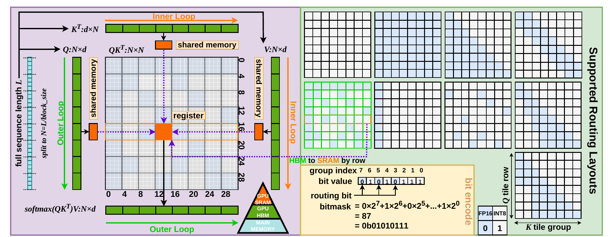

# TileMix: Tile-Centric Mixed-Precision Attention

TileMix is an inference-time attention kernel for long-context LLMs. It treats **precision as a spatial routing decision over hardware-aligned score-tile groups**: each legal tile group is routed to either an FP16 or INT8 score-computation path inside one fused attention kernel, while both paths update the same online-softmax state. TileMix preserves dense attention connectivity and requires no retraining.

<p align="center">
  
</p>

This repository contains the implementation accompanying **“TileMix: Tile-Centric Mixed-Precision Attention for LLM Inference Acceleration.”** The released code includes the Triton attention kernels, routing-map construction, and Hugging Face integrations for LLaMA- and Qwen-family models.

## Usage

Use Python 3.12 and a CUDA-enabled environment. For the prefill benchmark, install the CUDA 12.9 toolkit and GCC 14, with `nvcc`, the compiler, and Ninja on `PATH`, and set `CUDA_HOME` to the toolkit directory. Run the following commands from the repository root.

```bash
python -m pip install torch==2.9.0 --index-url https://download.pytorch.org/whl/cu128
python -m pip install triton==3.5.0 transformers==4.57.1 accelerate==1.11.0 ninja
```

### LLaMA

```bash
python examples/apply_tilemix_llama.py \
  --model meta-llama/Llama-3.2-3B-Instruct \
  --pattern sptrans \
  --percentage 0.50
```

Or integrate TileMix directly:

```python
from models.tilemix_llama import (
    inject_tilemix_into_llama,
    configure_tilemix_attention_pattern,
)

model = inject_tilemix_into_llama(model)
model = configure_tilemix_attention_pattern(
    model,
    pattern_type="sptrans",
    percentage=0.50,
)
```

### Prefill benchmark

```bash
python examples/benchmark_prefill.py \
  --model meta-llama/Llama-3.2-3B-Instruct \
  --batch-size 8 \
  --input-length 4096
```

The command runs FP16 LLaMA with SpTrans50, a KV cache, and last-position logits. It reports the median of 20 CUDA-event measurements after 5 warmups; loading, tokenization, compilation, and decoding are excluded. `--model` also accepts a local checkpoint directory.

### Qwen

```bash
python examples/apply_tilemix_qwen.py \
  --model Qwen/Qwen2-7B-Instruct \
  --pattern sptrans \
  --percentage 0.50
```

Or integrate TileMix directly:

```python
from models.tilemix_qwen import (
    inject_tilemix_into_qwen,
    configure_tilemix_attention_pattern,
)

model = inject_tilemix_into_qwen(model)
model = configure_tilemix_attention_pattern(
    model,
    pattern_type="sptrans",
    percentage=0.50,
)
```

`percentage` specifies the target fraction of legal tile groups routed to INT8. The implementation also supports the routing layouts used in the paper, including `zero`, `one`, `band`, `global`, `row_rand`, `align_sparse`, `bigbird`, and `sptrans`.
